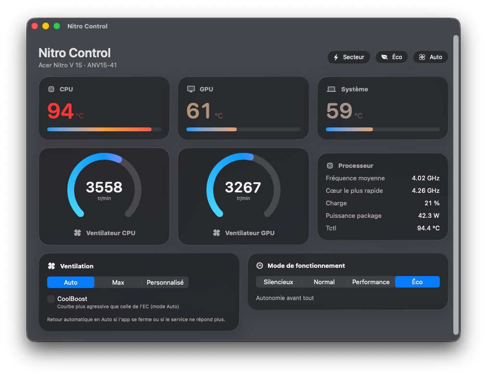

# Nitro Control pour Acer Nitro V 15 (ANV15-41)

Contrôle des ventilateurs et des modes de performance de l'Acer Nitro V 15 ANV15-41 sous macOS (Hackintosh), pour remplacer NitroSense, qui n'existe que sous Windows.



L'app affiche les températures CPU, GPU et système, la vitesse des deux ventilateurs, la fréquence et la puissance du processeur. Elle permet de choisir le mode de ventilation (Auto, Max ou vitesses personnalisées, plus une courbe CoolBoost) et le mode de fonctionnement du firmware (Silencieux, Normal, Performance, Éco). Une icône dans la barre des menus donne la température la plus haute et les mêmes réglages en un clic.

## Machine testée

| | |
|---|---|
| Modèle | Acer Nitro V 15 ANV15-41-R7EL |
| CPU / GPU | AMD Ryzen 5 7535HS, NVIDIA RTX 4050 Laptop |
| Système | macOS 26.7 (Tahoe), SMBIOS MacBookPro16,2 |
| Prérequis | SIP avec signature des kexts désactivée, Command Line Tools |

Le code vise ce modèle précis. Un autre Nitro ou Predator récent qui expose la même interface WMI peut fonctionner, mais rien n'a été vérifié ailleurs.

## Fonctionnement

NitroSense 5.2.84 pilote le matériel par la classe WMI du BIOS `AcerGamingFunction` (GUID `7A4DDFE7-5B5D-40B4-8595-4408E0CC7F56`). Les encodages ont été relevés dans le désassemblage de `AcerHardwareService.exe` et `AcerAgentService.exe`, puis vérifiés sur la machine :

| Fonction | Méthode WMI | Entrée |
|---|---|---|
| Capteurs | `GetGamingSysInfo` (5) | `(id << 8) \| 1` : 0x01 temp CPU, 0x02 ventilo CPU, 0x03 temp système, 0x06 ventilo GPU, 0x0A temp GPU |
| Mode ventilateurs | `SetGamingFanBehavior` (14) | bitmap des ventilos (CPU bit 0, GPU bit 3) et 2 bits de mode par ventilo à `16 + 2×bit` (1 Auto, 2 Max, 3 Perso) |
| Vitesse | `SetGamingFanSpeed` (16) | `(pourcentage << 8) \| index` (CPU 1, GPU 4) |
| Mode de fonctionnement | `SetGamingMiscSetting` (22) | `(mode << 8) \| 0x0B` (0 Silencieux, 1 Normal, 4 Performance, 6 Éco) |

Le projet a trois parties :

- `NitroWMI.kext` s'attache au device ACPI `WMID` (`_UID APGe`), trouve la méthode `WMBH` en lisant son `_WDG`, et l'expose à l'espace utilisateur. Il lit aussi l'EC (lecture seule), la température Tctl du Ryzen et les compteurs APERF/MPERF et RAPL. Les lectures sont ouvertes à tous les utilisateurs, les écritures demandent root.
- `nitrocontrold`, un daemon launchd lancé en root, garde le dernier réglage dans `/Library/Application Support/NitroControl/daemon.json` et le réapplique à chaque démarrage.
- `Nitro Control.app` (SwiftUI) et `nitroctl` en ligne de commande parlent au daemon par XPC.

## Sécurité

Les ventilateurs repassent sur la courbe automatique de l'EC dans plusieurs cas :

- l'app est fermée ou plantée (le daemon la considère absente après 15 s sans nouvelles) ;
- le daemon s'arrête ou plante : le kext le détecte à la fermeture de sa connexion ;
- le daemon se bloque : il ne relance plus le minuteur du kext, qui rétablit l'Auto au bout de 10 s ;
- en mode personnalisé, à partir de 95 °C côté CPU ou 87 °C côté GPU, les ventilateurs passent au maximum jusqu'à 85 °C et 78 °C.

Les commandes d'écriture restent verrouillées après l'installation, tant que vous n'avez pas vérifié la lecture des capteurs.

## Installation

### 1. Récupérer et compiler

```bash
git clone https://github.com/myvoow/nitro-control-anv15-41.git ~/NitroControl
cd ~/NitroControl
make all
```

`make all` compile le kext avec le SDK macOS 15.4 des Command Line Tools, puis le daemon, `nitroctl` et l'app. Pas besoin de Xcode.

### 2. Installer

```bash
make install
```

La commande demande votre mot de passe. Elle copie le kext dans `/Library/Extensions` et reconstruit la collection auxiliaire de kexts, installe le daemon (`/Library/LaunchDaemons/com.myvo.nitrocontrold.plist`), `nitroctl` dans `/usr/local/bin`, l'app dans `/Applications`, et un LaunchAgent qui ouvre l'app à chaque connexion. Si macOS le demande, autorisez l'extension dans Réglages Système > Confidentialité et sécurité.

### 3. Redémarrer

Le kext ne se charge qu'au démarrage. Après le redémarrage, vérifiez :

```bash
kmutil showloaded --list-only | grep NitroWMI
```

### 4. Tester la lecture

```bash
nitroctl sensors
```

Le test n'écrit rien. Chaque capteur doit être coché ✓, avec des valeurs cohérentes : températures entre 30 et 90 °C au repos, ventilateurs entre 2000 et 6500 tr/min, mode de fonctionnement connu.

### 5. Activer l'écriture

```bash
nitroctl writes on
```

Le réglage est gardé définitivement. À partir de là, l'app et `nitroctl` peuvent changer la ventilation et le mode de fonctionnement, et le dernier réglage revient à chaque démarrage.

## Ligne de commande

```bash
nitroctl status                     # état complet
nitroctl fan max                    # Ctrl-C rend la main au mode Auto si l'app est fermée
nitroctl fan custom 60 50           # CPU 60 %, GPU 50 %
nitroctl fan auto
nitroctl profile performance        # quiet, balanced, performance, eco
nitroctl info                       # kext, méthode WMI, table _WDG
nitroctl ec                         # dump des 256 registres de l'EC
nitroctl selftest                   # vérifie les encodages WMI
```

## Désinstallation

```bash
make uninstall
```

Puis redémarrer pour décharger le kext.

## Limites

- Ce modèle n'a pas de mode Turbo, et il n'a pas d'éclairage clavier pilotable : NitroSense le désactive pour l'ANV15-41.
- CoolBoost est une courbe logicielle du daemon. Je n'ai pas trouvé d'appel dédié dans NitroSense.
- `nitroctl acpi` lit les tables ACPI par un appel interne d'IOACPIFamily dont l'ABI n'est pas garantie. Ne l'utilisez qu'en connaissance de cause.
- L'icône est au format `.icns` classique. macOS 26 peut l'afficher dans un cadre gris.

Projet personnel, sans lien avec Acer. Utilisation à vos risques : une erreur de pilotage des ventilateurs peut faire chauffer la machine.
